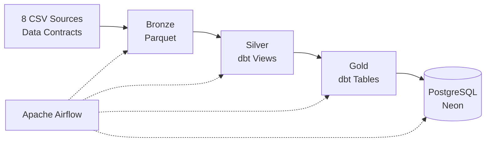

# Henrique Daniel da Rocha

**Software Engineer | Data Engineering | Python · SQL · AWS**

[LinkedIn](https://www.linkedin.com/in/henrique-daniel-rocha/) · [Email](mailto:henriquedan1702@gmail.com)

I'm a Software Engineer focused on Data Engineering, building reliable batch data pipelines with Python, SQL, dbt, DuckDB, and Apache Airflow.

I apply software engineering principles to data systems: explicit data contracts, automated testing, static typing, safe re-execution, and maintainable architecture.

I have also taught programming in a vocational Systems Development program and am currently seeking my first professional opportunity in Data Engineering.

**Education:** Software Engineering.

**Start here:** [Olist Delivery Review Pipeline](https://github.com/henriquerochaa/olist-delivery-review-pipeline) — my most complete project, with automated tests, documented architectural decisions, and known limitations.

---

## Technical Focus

- **Software Engineering:** Python, Django, Django REST Framework, backend development, automated testing, static typing, CI
- **Data Engineering:** ETL/ELT, batch pipelines, incremental ingestion, orchestration, data quality
- **Data Architecture:** dimensional modeling, data grain, medallion architecture, data warehousing, data lakes, lakehouse concepts
- **Technologies:** Python, SQL, Airflow, dbt, DuckDB, PostgreSQL, Parquet, GitHub Actions
- **Cloud:** AWS (S3, IAM, VPC, RDS, Glue, Athena, Lambda) — coursework and hands-on labs

---

## Featured Projects

### [Olist Delivery Review Pipeline](https://github.com/henriquerochaa/olist-delivery-review-pipeline)

**End-to-end batch data pipeline | Data Quality · Orchestration · Analytics**

**Problem:** How does delivery performance relate to customer review scores?

Built a batch data pipeline processing 8 public Olist datasets containing 550,759 source rows.

**Results:**
- Late deliveries average **2.27 stars**, compared with **4.29** for orders delivered before the estimated date, across an analysis of 99,441 orders.
- Orders without reviews (768) or delivery dates (2,965) are classified separately rather than silently discarded.
- Results are descriptive, not causal.

**Architecture**

**Engineering decisions**

- Source contracts and automated tests validate data before downstream processing.
- Publication checks dbt execution results, rejects failed or stale Gold data, and loads PostgreSQL in a single transaction using a least-privilege role.
- Batch identifiers support traceability and safe re-execution.

**Known limitations:** CSV files are loaded fully into memory; concurrent executions of the same batch are not coordinated across processes.

**Evidence:** [Data Contracts](https://github.com/henriquerochaa/olist-delivery-review-pipeline/tree/main/contracts) · [43 Python Tests](https://github.com/henriquerochaa/olist-delivery-review-pipeline/tree/main/tests) · [dbt Models & Tests](https://github.com/henriquerochaa/olist-delivery-review-pipeline/tree/main/dbt_pipeline_qualidade) · [Airflow DAG](https://github.com/henriquerochaa/olist-delivery-review-pipeline/tree/main/airflow)

`Python` `Pandas` `dbt` `DuckDB` `Airflow` `PostgreSQL`

---

### [BCB Indicators Pipeline](https://github.com/henriquerochaa/bcb-indicators-pipeline)

**Incremental Data Pipeline | In Development**

**Problem:** Build an incremental, auditable pipeline for three Central Bank of Brazil indicators: USD PTAX, Selic target rate, and monthly IPCA.

**Planned architecture:**

SGS API → Bronze (append by batch) → Silver (latest valid record per key) → Gold (monthly analytical data).

**Planned engineering decisions**

- Rolling re-read windows and upserts keyed by `(series, date)` to capture retroactive revisions.
- Explicit rejection tracking and batch-level reconciliation of received, accepted, and rejected records.
- Parquet and DuckDB for a lightweight architecture, with offline tests using recorded API responses.

**Implemented:** manually validated API contracts, recorded response fixtures, initial test scaffolding, CI workflow, and locked development environment.

**Remaining for v1.0:** API client, Bronze/Silver/Gold processing, incremental and backfill commands, pipeline tests, and CI execution with recorded responses.

`Python` `DuckDB` `Parquet` `GitHub Actions`

---

## Engineering Principles

**Reliability** · **Data Quality** · **Maintainability** · **Simplicity** · **Transparency**

I prioritize safe re-execution, explicit data contracts, well-defined data grain, automated validation, and architectures that match actual requirements.

I document known limitations and distinguish implemented functionality from planned improvements.

---

## Continuous Learning

I maintain a personal knowledge base with **320+ structured study notes**, connecting data engineering concepts to practical implementation whenever possible.

**Books completed**
- *Fundamentals of Data Engineering*
- *Decifrando Arquiteturas de Dados* (Understanding Data Architectures — translated title)

**Additional technical reading:** *Fundamentos da Qualidade de Dados* (Fundamentals of Data Quality), *Data Engineering Design Patterns*, *Python para Análise de Dados* (Python for Data Analysis), and *SQL para Análise de Dados* (SQL for Data Analysis).

**Courses:** Coursera Data Engineering specialization (courses 1–4) and AWS Essential.

<strong>Explore my knowledge base and applied evidence</strong>

| Area | Topics | Applied Evidence |
|---|---|---|
| **Fundamentals** | Data engineering lifecycle, requirements, security, cost, build vs. buy | Theoretical study |
| **Architecture** | Warehouse, lake, lakehouse, mesh, fabric, medallion architecture | [Medallion layers](https://github.com/henriquerochaa/olist-delivery-review-pipeline/tree/main/dbt_pipeline_qualidade) |
| **Ingestion** | APIs, batch, streaming, ETL/ELT, CDC, Kafka, Kinesis | [Batch ingestion](https://github.com/henriquerochaa/olist-delivery-review-pipeline/tree/main/src); incremental API ingestion in development |
| **Orchestration & DataOps** | Airflow, Terraform, observability, contracts, CI | [Airflow DAG](https://github.com/henriquerochaa/olist-delivery-review-pipeline/tree/main/airflow) · [Contracts](https://github.com/henriquerochaa/olist-delivery-review-pipeline/tree/main/contracts) |
| **Storage & Querying** | Columnar storage, Parquet, indexes, analytical engines, Redshift | Parquet and DuckDB in Olist |
| **Modeling & Transformation** | Normalization, star schema, dimensional modeling, SCD, dbt | [dbt models](https://github.com/henriquerochaa/olist-delivery-review-pipeline/tree/main/dbt_pipeline_qualidade) |
| **Data Quality** | Testing, reconciliation, lineage, anomalies | [Python tests](https://github.com/henriquerochaa/olist-delivery-review-pipeline/tree/main/tests) · dbt checks |
| **Engineering Patterns** | Idempotency, error handling, reliability, observability | Batch-based re-execution in Olist |
| **Python & SQL** | Pandas, CTEs, analytical SQL, time series, data transformations | Python ingestion and SQL transformations in Olist |
| **AWS** | S3, EC2, IAM, VPC, RDS, DynamoDB, Lambda, Glue, Athena, CloudWatch | Coursework and hands-on labs |

**Currently exploring:** Apache Spark, Databricks, Delta Lake, additional orchestration approaches, and AWS analytical workloads.

---

## Connect

I'm open to junior Data Engineering opportunities where I can apply my software engineering background to building reliable data systems.

[LinkedIn](https://www.linkedin.com/in/henrique-daniel-rocha/) · [Email](mailto:henriquedan1702@gmail.com)
