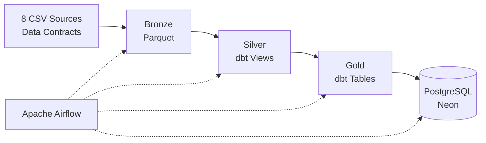
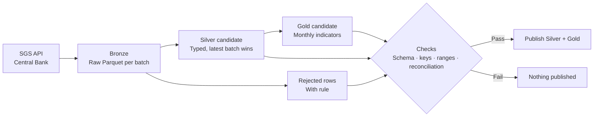

# Henrique Daniel da Rocha

**Software Engineer | Data Engineering | Python · SQL · AWS**

[LinkedIn](https://www.linkedin.com/in/henrique-daniel-rocha/) · [Email](mailto:henriquedan1702@gmail.com)

I'm a Software Engineer focused on Data Engineering. I build batch and incremental data pipelines using Python, SQL, dbt, DuckDB, and Apache Airflow, applying software engineering practices such as data contracts, automated testing, static typing, and CI.

I have taught programming in a vocational Systems Development program and am seeking my first professional role in Data Engineering.

## Technical Skills

- **Data Engineering:** ETL/ELT, batch and incremental ingestion, data quality, orchestration, dimensional modeling
- **Languages & tools:** Python, SQL, Pandas, dbt, DuckDB, PostgreSQL, Parquet, Apache Airflow
- **Software Engineering:** automated tests, static typing, Git, GitHub Actions, Django, Django REST Framework
- **Cloud:** AWS (S3, IAM, VPC, RDS, Glue, Athena, Lambda) through coursework and hands-on labs

## Featured Projects

### [Olist Delivery Review Pipeline](https://github.com/henriquerochaa/olist-delivery-review-pipeline)

**Batch pipeline · Data contracts · dbt · Airflow · PostgreSQL**

Analyzes how delivery performance relates to customer review scores using eight public Olist datasets (550,759 source rows).

- Across 99,441 orders, late deliveries averaged **2.27 stars**, versus **4.29** for deliveries before the estimated date. This is descriptive, not causal.
- Separately classifies orders without reviews (768) or delivery dates (2,965), rather than silently dropping them.
- Applies source contracts, automated tests, and checks before publication to PostgreSQL.

**Engineering focus:** validation before downstream processing, traceable batch execution, transactional publication, and least-privilege database access.

**Known limitations:** CSV inputs are loaded into memory; concurrent runs of the same batch are not coordinated across processes.

**Evidence:** [Data contracts](https://github.com/henriquerochaa/olist-delivery-review-pipeline/tree/main/contracts) · [43 Python tests](https://github.com/henriquerochaa/olist-delivery-review-pipeline/tree/main/tests) · [dbt models and tests](https://github.com/henriquerochaa/olist-delivery-review-pipeline/tree/main/dbt_pipeline_qualidade) · [Airflow DAG](https://github.com/henriquerochaa/olist-delivery-review-pipeline/tree/main/airflow)

### [BCB Indicators Pipeline](https://github.com/henriquerochaa/indicadores-bcb-pipeline)

**Incremental ingestion · Public API · Validation · Recovery**

Ingests three Central Bank of Brazil indicators (USD PTAX, Selic target rate, and IPCA), including a re-read window to capture revisions to historical values.

- Initial load: **18,613 rows**, zero rejections, and **389 months** of Gold data.
- Reconciles Bronze, Silver, rejected, and superseded records to make data movement auditable.
- Builds candidate Silver and Gold layers, validates them, and publishes only when checks pass; includes recovery logic for interrupted swaps.

**Engineering focus:** watermark-based incremental ingestion, revision handling, write-audit-publish, reconciliation, and failure recovery.

**Known limitations:** no retry for HTTP 5xx responses (only connection retries); revisions older than the re-read window require a full reload; no scheduling yet, and concurrent runs are not supported; swaps use sequential renames rather than transactional table formats.

**Evidence:** [67 offline tests](https://github.com/henriquerochaa/indicadores-bcb-pipeline/tree/main/tests) · [Series contracts](https://github.com/henriquerochaa/indicadores-bcb-pipeline/blob/main/contracts/series.yaml) · [SQL queries](https://github.com/henriquerochaa/indicadores-bcb-pipeline/tree/main/queries) · [CI workflow](https://github.com/henriquerochaa/indicadores-bcb-pipeline/actions)

## Education & Continuous Learning

- **Education:** Software Engineering
- **Courses:** Coursera Data Engineering specialization (3 courses completed, 4th in progress); AWS Essential
- **Study:** Data architecture, modeling, reliability, and quality, supported by a personal knowledge base of 320+ structured notes
- **Currently exploring:** Apache Spark, Databricks, Delta Lake, and AWS analytics workloads

## Engineering Approach

I prioritize clear data grain and contracts, repeatable processing, validation before publication, and architecture proportional to actual requirements. Each project documents implemented features, trade-offs, and known limitations.

## Connect

I'm open to junior Data Engineering opportunities where my software engineering background can help build reliable data systems.

[LinkedIn](https://www.linkedin.com/in/henrique-daniel-rocha/) · [Email](mailto:henriquedan1702@gmail.com)
